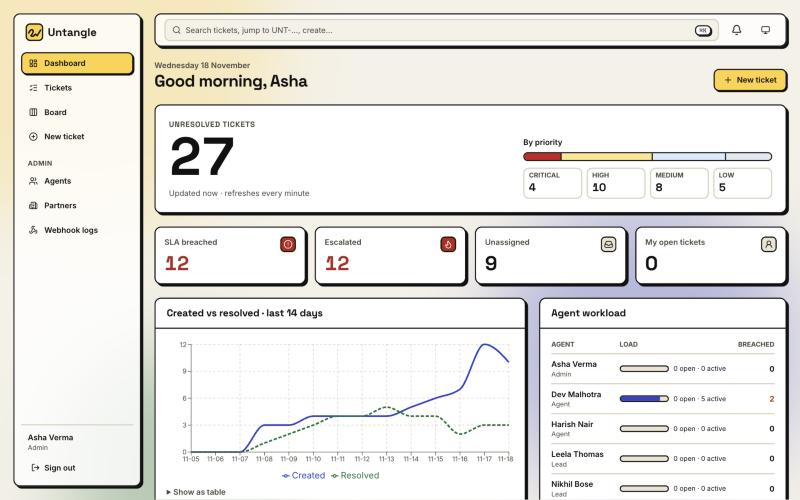
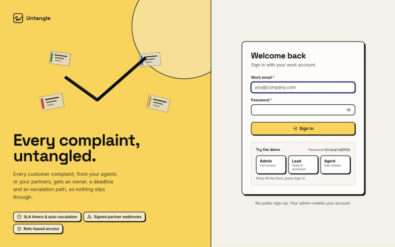
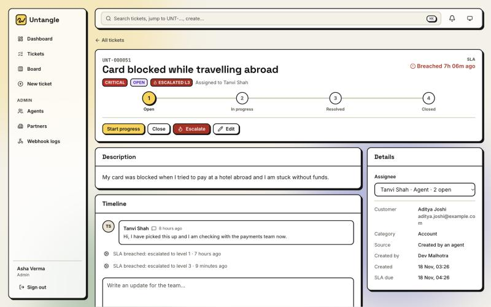
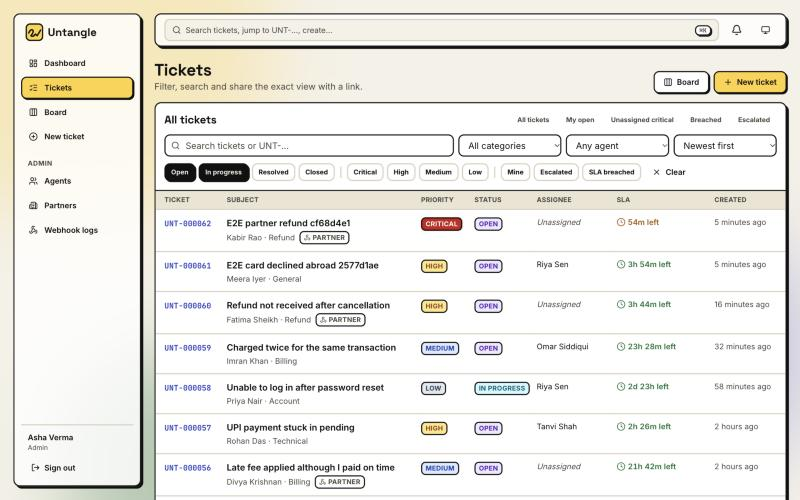
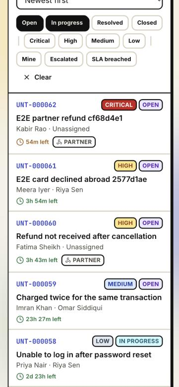
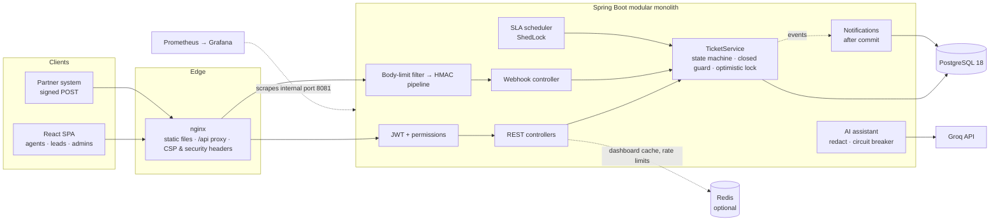
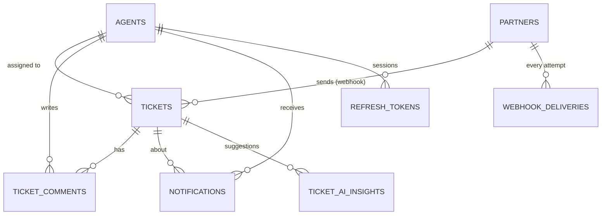
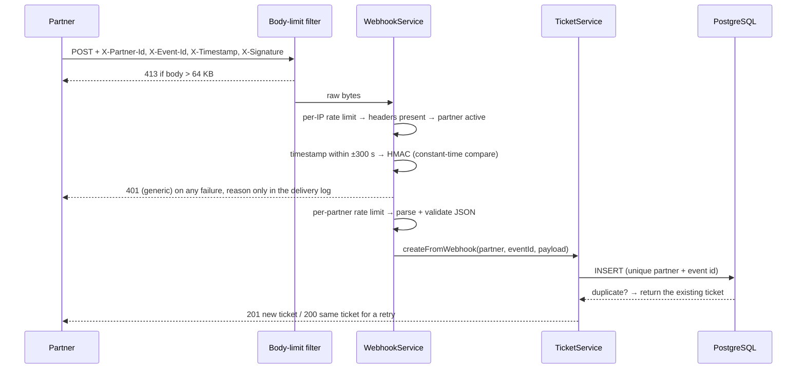

# Untangle

> **Every complaint, untangled.**

Untangle is a customer-support ticket and escalation platform. Every customer complaint becomes a
ticket that is **prioritised, assigned, tracked through a strict lifecycle, discussed, escalated
when it breaches its SLA, and never duplicated**, whether an agent typed it in or a partner system
sent it through an **HMAC-signed webhook**.



| | |
|---|---|
| **Backend** | Java 21 · Spring Boot 4.1 · Spring Security (JWT) · PostgreSQL 18 · Flyway · Micrometer |
| **Frontend** | React 19 · TypeScript 6 · Vite 8 · Tailwind v4 · TanStack Query · React Three Fiber |
| **Infra** | Docker Compose · nginx · GitHub Actions · Prometheus + Grafana · optional Redis |
| **Quality** | 443 backend tests · 74 frontend tests · 14 Playwright E2E (incl. layout guard at 4 sizes × 3 roles) · 111 live feature/RBAC/AI checks · 17 webhook scenarios · coverage ≥ 80 % · Lighthouse 91–100 |

---

## Contents

1. [Quick start](#quick-start)
2. [Features](#features)
3. [Requirements coverage](#requirements-coverage)
4. [Screens](#screens)
5. [Architecture (HLD)](#architecture-hld)
6. [Key flows](#key-flows)
7. [Security](#security)
8. [Design decisions](#design-decisions)
9. [Trade-offs](#trade-offs)
10. [Performance and scalability](#performance-and-scalability)
11. [Observability](#observability)
12. [Testing](#testing)
13. [Commands](#commands)
14. [Repository layout](#repository-layout)
15. [Documentation map](#documentation-map)
16. [Known limitations](#known-limitations)

---

## Quick start

Requires Docker Desktop.

```bash
make up            # builds and starts postgres + backend + frontend, waits until healthy
```

Open **<http://localhost:3000>**. The stack starts with demo data (9 staff, 60 tickets, 1 partner).
On the login page, the **Admin / Lead / Agent** buttons fill in a demo account (password for all:
`Untangle@2026`).

| Role | Email | What they can do |
|---|---|---|
| Admin | `admin@untangle.local` | everything, incl. agents, partners and webhook logs |
| Lead | `leela.thomas@untangle.local` | assign anyone, close, reopen, see team workload |
| Agent | `riya.sen@untangle.local` | work own tickets, assign self, comment, resolve |

Then try:

```bash
make simulate      # a partner sends signed webhooks: 17 scenarios with a pass/fail table
make e2e           # browser end-to-end tests against the running stack
```

Other entry points: API docs at <http://localhost:8080/swagger-ui.html>, metrics with
`docker compose --profile observability up -d` (Grafana <http://localhost:3001>).

Local development with hot reload (JDK 21 + Node 26): `make setup`, then `make backend-run` and
`make frontend-dev` (<http://localhost:5173>). A step-by-step tour of every feature is in
[docs/manual-test-guide.md](docs/manual-test-guide.md).

---

## Features

**Tickets**
- Create tickets with customer, description, category and a mandatory, validated priority.
- Ticket numbers `UNT-000123`; search by number, subject, customer or description.
- Lifecycle `OPEN → IN_PROGRESS → RESOLVED → CLOSED` enforced by a state machine: resolving needs a
  resolution note, closing an open ticket needs a reason, closed tickets are read-only until a lead
  reopens them (with a reason).
- Assignment by leads/admins (with each agent's open workload shown) or "Assign to me" for agents.
- Append-only timeline: comments, resolution notes and automatic system events.
- Optimistic locking: two people editing at once get a "this ticket changed" dialog, never a silent
  overwrite.

**Finding work**
- Filters by status, priority, category, assignee, unassigned, mine, escalated and SLA-breached,
  combinable, saved in the URL (shareable, back-button friendly), with quick views.
- Dashboard: unresolved count, breakdown by priority, SLA-breached / escalated / unassigned / mine,
  14-day trend, agent workload. Every number equals the matching filtered list.
- Kanban board with drag and drop (or "Move to…" on phones and keyboards).
- Command palette (Ctrl/⌘ + K) and keyboard shortcuts.

**SLA and escalation**
- Per-priority SLA deadlines with a live countdown; changing the priority recalculates it.
- A scheduler (one instance at a time, via ShedLock) escalates breached tickets every minute;
  manual escalation with a reason. Leads and assignees are notified (bell with unread count).

**Partner webhook (HMAC)**
- `POST /api/v1/webhooks/partners/tickets` signed with HMAC-SHA256 over `timestamp.rawBody`.
- Rejects bad signatures, stale timestamps (±5 min), unknown or disabled partners, bodies over
  64 KB, and floods (per-IP and per-partner rate limits). All failures return the same generic 401.
- **Duplicate event IDs never create duplicate tickets**: a database unique index makes it true even
  for 20 simultaneous retries.
- Partner secrets are encrypted at rest (AES-GCM), shown once, and rotated with a 24 h grace period.
- Every delivery attempt is logged with its outcome for debugging.

**People and access**
- JWT sign-in with refresh-token rotation and reuse detection; account lockout after 5 failures.
- Role-based access via permissions; the UI shows only what the server allows, and disabled buttons
  explain why.
- Admin screens for agents (deactivation moves their open tickets first) and partners.

**Auto-assign**: switch it on and every waiting ticket goes to the least busy agent who handles its category, most urgent first, with a cap per agent and a reason on the timeline ([ADR-029](docs/decisions/ADR-029-automatic-assignment-least-loaded.md)).

**AI teammate + assistance (optional)**: assign a ticket to "Unty" and it replies and proposes a resolution for a lead to approve ([ADR-028](docs/decisions/ADR-028-ai-teammate-proposes-human-approves.md)).

**AI assistance (optional)**
- With a Groq API key: suggested category/priority on intake, ticket summaries and draft resolution notes.
- Suggestions only: the model can never change data. Personal data is redacted before sending.

**Experience**
- Loud neo-brutalist design (thick outlines, hard shadows, sticker cards, dotted wash) with twelve pop-colour themes and light/dark mode; toon-style 3D about the product: a support desk on the login (ticket stamped RESOLVED, SLA stopwatch, escalation levels, HMAC padlock) and real per-priority ticket stacks on the dashboard (switchable off; never on phones or with reduced motion).
- 3D login scene (a knot untangling into the checkmark logo), page and shared-element transitions.
- Works on phones; reduced-motion and low-power devices get a calm static version.
- WCAG-minded: keyboard navigation, focus rings, screen-reader labels, automated axe checks.

---

## Requirements coverage

| Requirement | How it is met | Proof |
|---|---|---|
| Create tickets: customer name, description, category, priority | form + `POST /tickets` + webhook | `TicketLifecycleIntegrationTest`, E2E lifecycle |
| Assign tickets to agents | assignee picker, `PUT /tickets/{id}/assignee`, bulk assign | lifecycle + RBAC tests |
| Statuses OPEN, IN_PROGRESS, RESOLVED, CLOSED | `TicketStateMachine` (all 16 from→to pairs tested) | `TicketStateMachineTest` |
| Comments and resolution notes | append-only timeline | comment tests, E2E |
| Filter by priority, assigned agent, status | URL-synced filters, JPA Specifications | `TicketQueryIntegrationTest` |
| Unresolved count on the dashboard | `GET /dashboard/summary` | `everyCountMatchesTheEquivalentListFilter` |
| Ticket creation through a signed webhook, HMAC checked first | `WebhookService` pipeline | 17 simulator scenarios, webhook tests, E2E |
| Tables tickets, agents, ticket_comments | Flyway `V1__init.sql` (+ partners, deliveries, notifications) | repository tests |
| React screens: dashboard, detail, create/assign | plus board, admin, login | E2E + component tests |
| **Rule:** closed tickets can't be modified without reopening | one guard in the service + DB check | `closedTicketsRejectEveryMutation` |
| **Rule:** every ticket has a valid priority | Bean Validation + enum + DB CHECK | `rejectsInvalidTickets`, `rejectsNullPriority` |
| **Rule:** duplicate external event IDs never duplicate tickets | unique index (partner, event id) | 20-concurrent-request tests |

The full edge-case list (110+ cases, each with its test) is in [docs/edge-cases.md](docs/edge-cases.md).

---

## Screens

| Login | Ticket detail |
|---|---|
|  |  |

| Tickets with filters | On a phone |
|---|---|
|  |  |

---

## Architecture (HLD)

One backend with **two front doors** and **one brain**: people use the React app with a JWT,
partners call the webhook with an HMAC signature, and both end in the same `TicketService`, so the
rules can never differ by channel.



**Code organisation.** Package-by-feature under `dev.untangle`: `auth agent ticket comment webhook
escalation notification dashboard ai` plus shared `common config security`. Every feature has the
same layers, enforced by ArchUnit tests:

```
api            controllers, request/response DTOs      (entities never reach here)
application    services, use cases, events, metrics
domain         entities, enums, state machine, rules   (no Spring)
infrastructure repositories, specifications            (private to the feature)
```

Cross-feature calls go through another feature's `application` services or events, never its
repositories. Frontend: `src/features/<feature>`, shared UI in `src/components`, generated API types
in `src/lib/api`.

**Data model** (UUIDv7 keys, Flyway migrations, Hibernate in validate mode; every invariant is also
a named database constraint):



Details: [architecture](docs/architecture.md) · [database](docs/database.md) ·
[state machine](docs/state-machine.md) · [API](docs/api.md).

---

## Key flows

**Partner webhook** (order matters: cheapest and safest checks first, every exit is logged):



**Ticket change** (every mutation follows the same steps): load → closed guard → version check →
permission policy → entity behaviour → timeline entry → event after commit (notifications, metrics,
cache eviction).

**Sign-in**: password (BCrypt) → short-lived access token in memory + rotating refresh token in an
HttpOnly cookie; reuse of an old refresh token revokes the whole session family.

---

## Security

| Area | What we do |
|---|---|
| Authentication | JWT (HS256, 15 min) in memory only; refresh token in an `HttpOnly`, `Secure`, `SameSite` cookie, rotated on every use, reuse detection; BCrypt cost 12; lockout after 5 failures |
| Authorisation | permissions per role, checked on every endpoint and per ticket (`TicketAccessPolicy`); the UI only reflects `allowedActions` from the server |
| Webhook | HMAC-SHA256 over `timestamp.rawBody`, constant-time comparison, ±5 min replay window, generic 401s, per-IP and per-partner limits, 64 KB body cap |
| Secrets | from environment only, startup fails if missing or weak; partner secrets AES-GCM-encrypted with the partner code as associated data; shown once |
| Input/output | Bean Validation everywhere; JPA parameters only (no SQL strings); comments rendered as text (no HTML execution); RFC 9457 errors without stack traces |
| Browser | strict CSP (no inline scripts), `X-Frame-Options: DENY`, `nosniff`, `Referrer-Policy`, `Permissions-Policy`; checked by E2E tests |
| Operations | metrics on an unpublished port; containers non-root with health checks; tokens, passwords and full emails never logged; correlation id on every request |
| AI | off by default; PII redacted, ticket text fenced against prompt injection, output validated; the AI teammate only proposes, a lead approves (ADR-028) |
| Supply chain | Dependabot for Maven, npm, Docker and Actions; `npm audit` in CI |

Threat model, RBAC matrix and checklists: [docs/security.md](docs/security.md).

---

## Design decisions

Every significant choice has an Architecture Decision Record in [docs/decisions/](docs/decisions/).

| ADR | Decision |
|---|---|
| [001](docs/decisions/ADR-001-modular-monolith-package-by-feature.md) | Modular monolith, package-by-feature, enforced by ArchUnit |
| [002](docs/decisions/ADR-002-java-21-spring-boot-4.md) | Java 21 LTS + Spring Boot 4 |
| [003](docs/decisions/ADR-003-flyway-migrations.md) | Flyway SQL migrations, Hibernate only validates |
| [004](docs/decisions/ADR-004-local-toolchain-docker-runtime.md) | Local toolchain for development, Docker for running |
| [005](docs/decisions/ADR-005-redis-optional.md) | Redis optional, never required |
| [006](docs/decisions/ADR-006-frontend-toolchain.md) | React 19 + Vite + Tailwind v4 + strict TypeScript |
| [007](docs/decisions/ADR-007-response-and-error-format.md) | Plain DTOs; RFC 9457 Problem Details for errors |
| [008](docs/decisions/ADR-008-uuidv7-primary-keys.md) | UUIDv7 primary keys |
| [009](docs/decisions/ADR-009-varchar-check-for-enums.md) | Enums as `varchar` + CHECK constraints |
| [010](docs/decisions/ADR-010-append-only-comments.md) | Append-only comments (audit trail) |
| [011](docs/decisions/ADR-011-optimistic-locking.md) | Optimistic locking with a version field |
| [012](docs/decisions/ADR-012-db-unique-constraint-for-idempotency.md) | Idempotency by a database unique constraint |
| [013](docs/decisions/ADR-013-jwt-and-refresh-rotation.md) | JWT + rotating refresh tokens with reuse detection |
| [014](docs/decisions/ADR-014-rbac-via-permissions.md) | Authorise by permissions, not role names |
| [015](docs/decisions/ADR-015-allowed-actions-from-server.md) | Server decides `allowedActions` / `deniedActions` |
| [016](docs/decisions/ADR-016-aes-gcm-partner-secrets.md) | Partner secrets encrypted with AES-GCM |
| [017](docs/decisions/ADR-017-hmac-over-timestamp-and-raw-body.md) | HMAC over timestamp + raw body |
| [018](docs/decisions/ADR-018-generic-webhook-errors-and-delivery-log.md) | Generic webhook errors, detailed delivery log |
| [019](docs/decisions/ADR-019-partner-simulator-node-typescript.md) | Partner simulator in Node + TypeScript |
| [020](docs/decisions/ADR-020-sla-scheduler-with-shedlock.md) | SLA scheduler guarded by ShedLock |
| [021](docs/decisions/ADR-021-notifications-polling-over-sse.md) | Notifications by polling (SSE deferred) |
| [022](docs/decisions/ADR-022-ai-suggestion-only.md) | AI optional and suggestion-only (amended by 028) |
| [023](docs/decisions/ADR-023-exact-api-contract-and-vendored-react-bits.md) | Exact OpenAPI contract for generated types; vendored React Bits |
| [024](docs/decisions/ADR-024-motion-and-3d-budget.md) | 3D and motion built cheaply, within a performance budget |
| [025](docs/decisions/ADR-025-frosted-glass-colour-themes-and-ambient-3d.md) | Frosted glass, ten colour themes and an ambient 3D layer (amended by 026) |
| [026](docs/decisions/ADR-026-nebula-glass-and-contained-3d-stages.md) | Nebula glass, sixteen colour themes, 3D only in contained stages (superseded) |
| [027](docs/decisions/ADR-027-loud-neo-brutalism-and-toon-3d.md) | Loud neo-brutalism, twelve palettes, toon 3D about the product |
| [028](docs/decisions/ADR-028-ai-teammate-proposes-human-approves.md) | An AI teammate that proposes; a lead approves |
| [029](docs/decisions/ADR-029-automatic-assignment-least-loaded.md) | Automatic assignment to the least busy agent who handles the ticket |

Agreed deviations from the original brief are listed at the top of
[MASTER_PROMPT.md](MASTER_PROMPT.md); open questions and assumptions in
[docs/assumptions-and-open-questions.md](docs/assumptions-and-open-questions.md).

---

## Trade-offs

The main ones (full list with reasons in [docs/tradeoffs.md](docs/tradeoffs.md); every decision, the escalation basis and the HMAC pipeline explained on one page in [docs/engineering-decisions.md](docs/engineering-decisions.md)):

| Chose | Over | Because | Cost |
|---|---|---|---|
| Modular monolith | microservices | one team, one database, simple deploys | must keep module boundaries disciplined (ArchUnit) |
| DB unique index for idempotency | Redis/in-memory "seen" sets | correct under concurrency and restarts | a duplicate costs one failed insert |
| Optimistic locking | pessimistic locks | no lock waits for a read-heavy UI | users occasionally see a conflict dialog |
| Polling (bell 15 s, open ticket 10 s, lists 20 s) | SSE/WebSockets | works through every proxy, stateless, pauses in hidden tabs | changes appear within seconds, not instantly |
| Close, never delete tickets | hard delete | audit trail | data only grows (partitioning documented) |
| Synchronous webhook processing | queue + worker | immediate 201/200 answer, simpler | bursts are absorbed by rate limits, not a queue |
| Access token in memory | localStorage | XSS can't steal a stored token | a silent refresh on every reload |
| 3D only on the desktop login | 3D everywhere | the work screens stay fast | less spectacle inside the app |

---

## Performance and scalability

Measured on the Docker stack (details in [docs/scalability.md](docs/scalability.md)):

| What | Result |
|---|---|
| **Stress test** (`make stress`): realistic mix on 200k tickets, one backend | **~375 req/s with 0 % errors** (about 1,800 people online); database CPU is the limit. Found and fixed a search full-scan, a cache stampede and a virtual-thread freeze ([details](docs/scalability.md#stress-test-where-does-one-server-break-make-stress)) |
| Ticket list with filters, 50 req/s (k6) | p95 **5.3 ms**, 0 % errors |
| Webhook, steady 4 req/s | p95 **21 ms**, all accepted |
| Webhook, 50 req/s burst from one IP | limiter returns clean 429s, p95 6.5 ms |
| Dashboard, Lighthouse desktop | Performance 100 · Accessibility 100 · Best practices 100 |
| Dashboard, Lighthouse mobile (slow 4G, 4× CPU) | 91 · 100 · 100 |
| Main JS bundle | 86 kB gzip (3D, charts, palette in lazy chunks) |
| List queries at 200k tickets | index-backed, verified with `EXPLAIN ANALYZE` ([database.md](docs/database.md)) |

Scale-out ready: stateless JWT backend, ShedLock for the scheduler, optional Redis for a shared
dashboard cache and cluster-wide rate limits, constant-query list endpoints (N+1 guard test).

---

## Observability

- Every request has an `X-Request-Id`; it appears in every log line (JSON in Docker), in the response
  header and in every error's `traceId`.
- Business metrics: `ticket_creations_total{source}`, `ticket_transitions_total{from,to}`,
  `sla_breaches_total{level}`, `webhook_requests_total{outcome}`, `ai_requests_total{feature,outcome}`,
  plus latency histograms; scraped from an internal port.
- `docker compose --profile observability up -d` starts Prometheus and Grafana with a provisioned
  "Untangle overview" dashboard.
- Health: `/livez`, `/readyz`. Details: [docs/observability.md](docs/observability.md).

---

## Testing

| Layer | Tool | Count |
|---|---|---|
| Unit + integration (real PostgreSQL in Testcontainers, never H2) | JUnit 6, AssertJ, MockMvcTester | 443 |
| Architecture rules | ArchUnit | included above |
| Frontend components, accessibility (axe) | Vitest, Testing Library, MSW | 74 |
| Every feature through the API + live RBAC matrix | `make check-features` | 103 checks |
| End-to-end in a real browser (incl. layout: no overlap or sideways scroll at phone, tablet, laptop, desktop) | Playwright | 14 |
| Partner webhook scenarios | Node simulator | 17 |
| Load | k6 | 2 scripts |
| Performance + accessibility | Lighthouse | dashboard, mobile + desktop |

Coverage gate: every service and domain package ≥ 80 % lines, whole backend ≥ 80 % lines and
≥ 65 % branches (`mvn verify` fails below). CI runs lint, types, all tests, the Docker stack, the
simulator and Playwright. Details: [docs/testing.md](docs/testing.md).

---

## Commands

```bash
make up | down | logs | ps          # Docker stack
make nuke                           # stop and DELETE local data (asks first)
make test | test-backend | test-frontend
make lint | typecheck | fmt | build | ci
make e2e | check-features | simulate | load | lighthouse
make backend-run | frontend-dev     # local development
make api-types                      # regenerate TypeScript types from the OpenAPI spec
make help                           # everything
```

Optional profiles: `docker compose --profile observability up -d` (Prometheus + Grafana),
`--profile redis` with `SPRING_PROFILES_ACTIVE=prod,demo,redis` (shared cache and rate limits).
AI: set `AI_ENABLED=true` and `GROQ_API_KEY` in `.env`, then `make up`.

---

## Repository layout

```
backend/            Spring Boot API (package-by-feature under dev.untangle)
frontend/           React SPA, nginx image, Playwright E2E (frontend/e2e)
partner-simulator/  Node CLI that plays an external partner sending signed webhooks
infra/              Prometheus config, Grafana provisioning and dashboard
load/k6/            load-test scripts
scripts/            Lighthouse helper
docs/               design docs, ADRs, runbook, manual test guide, per-phase notes
docker-compose.yml  postgres · backend · frontend (+ redis, observability, simulator profiles)
Makefile            every developer command
MASTER_PROMPT.md    the full specification and agreed deviations
```

---

## Documentation map

| Read this | For |
|---|---|
| [manual-test-guide.md](docs/manual-test-guide.md) | trying every feature by hand |
| [demo-script.md](docs/demo-script.md) | presenting the project in 10 minutes |
| [architecture.md](docs/architecture.md) | components, layers, request flows |
| [database.md](docs/database.md) | schema, constraints, indexes, query plans |
| [api.md](docs/api.md) | every endpoint, filters, errors |
| [webhook-integration-guide.md](docs/webhook-integration-guide.md) | how a partner integrates (with code in 4 languages) |
| [state-machine.md](docs/state-machine.md) | ticket lifecycle and SLA rules |
| [security.md](docs/security.md) | threat model, RBAC matrix, hardening |
| [tradeoffs.md](docs/tradeoffs.md) · [scalability.md](docs/scalability.md) | choices and how to scale |
| [observability.md](docs/observability.md) · [runbook.md](docs/runbook.md) | operating it |
| [frontend-design-system.md](docs/frontend-design-system.md) | design tokens, components, motion |
| [ai-features.md](docs/ai-features.md) | the optional AI pipeline |
| [testing.md](docs/testing.md) · [edge-cases.md](docs/edge-cases.md) | tests and the edge cases they cover |
| [how-it-works/](docs/how-it-works/) | one plain-English note per build phase |

---

## Known limitations

- Live updates are polling, not push: notifications within ~15 s, an open ticket within ~10 s, lists within ~20 s (ADR-021).
- The webhook is processed synchronously; very large partner bursts are rate-limited rather than
  queued (an outbox + queue design is in [scalability.md](docs/scalability.md)).
- Without a Groq key the AI features stay hidden; they were tested against a fake Groq server.
- HSTS is only sent behind HTTPS; the local stack is plain HTTP.
- The GitHub Actions pipeline is defined but runs only once the repository is pushed to GitHub.
