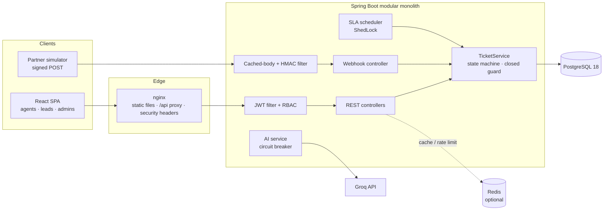
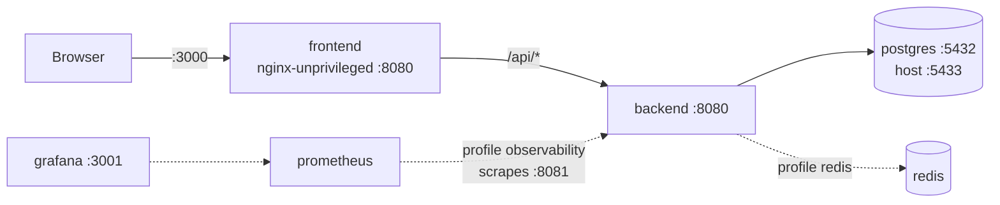
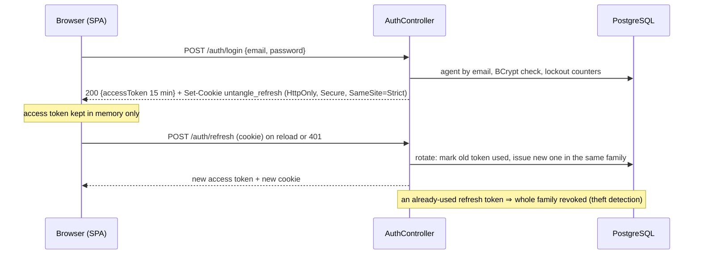

# Architecture

## Simple explanation

Untangle is **one backend application** with **two front doors**:

1. **People** (agents, leads, admins) use the React web app. Their requests carry a login token (JWT).
2. **Partner systems** send tickets to a webhook. Their requests carry a signature (HMAC) that proves
   they know the shared secret.

Both doors lead to the **same "brain"** (the ticket service), so the rules (valid priority, closed
tickets are frozen, no duplicates) are always the same no matter where a ticket came from.

Inside, the code is organised **by feature** (tickets, webhooks, auth, ...) rather than by technical
layer, so everything about one feature sits together and features can't reach into each other's
internals.

## Technical details

### Components



### Package-by-feature (backend)

`dev.untangle.<feature>` for `auth`, `agent`, `ticket`, `comment`, `webhook`, `escalation`,
`notification`, `dashboard`, `ai`, plus shared `common`, `config` and `security`. Every feature has
the same four layers:

| Layer | Holds | May use |
|---|---|---|
| `api` | controllers, request/response DTOs | `application` |
| `application` | services (use cases), events, mappers, metrics | `domain`, its own `infrastructure`, other features' `application` |
| `domain` | entities, enums, state machine, policies (no Spring) | nothing outside `domain` |
| `infrastructure` | repositories, JPA specifications | `domain` |

Entities never reach `api`; repositories are private to their feature; features talk through
`application` services or events. `ArchitectureTest` (ArchUnit) fails the build otherwise. See
[ADR-001](decisions/ADR-001-modular-monolith-package-by-feature.md).

### Runtime topology (Docker Compose)



- The browser only talks to **one origin** (nginx), which proxies `/api` to the backend, so the app
  needs no CORS in Docker. In local dev, Vite's proxy plays the same role.
- Every container runs as a **non-root** user and has a **healthcheck**. `make up` waits until all
  are healthy.

### Request flows

**Sign-in and silent refresh**



**Ticket transition** (every mutation has the same shape)

```mermaid
sequenceDiagram
  participant UI as Ticket page
  participant C as TicketController
  participant S as TicketService
  participant P as TicketAccessPolicy
  participant DB as PostgreSQL
  UI->>C: POST /tickets/{id}/transitions {targetStatus, note?, reason?, version}
  C->>S: transition(id, command, me)
  S->>DB: load ticket
  S->>S: closed guard (409 TICKET_CLOSED) → version check (409 VERSION_CONFLICT)
  S->>P: may this agent do RESOLVE here? (403 / 409 INVALID_STATUS_TRANSITION)
  S->>S: Ticket.transitionTo() via TicketStateMachine; timestamps
  S->>DB: save + resolution note + SYSTEM timeline entry
  S-->>UI: 200 TicketDetail with new allowedActions
  Note over S: after commit: notifications, metrics, dashboard cache eviction
```

**Partner webhook**: see the sequence in the [README](../README.md#key-flows) and the full
contract in [webhook-integration-guide.md](webhook-integration-guide.md).
