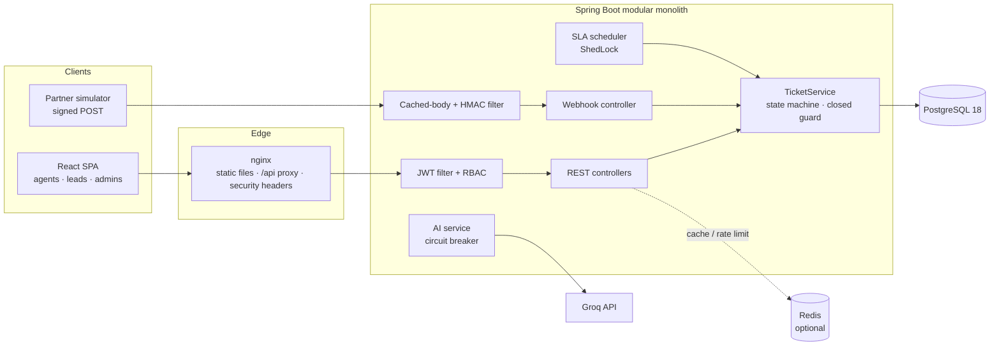
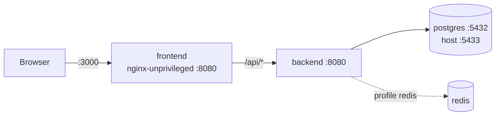

# Architecture

## Simple explanation

Untangle is **one backend application** with **two front doors**:

1. **People** (agents, leads, admins) use the React web app. Their requests carry a login token (JWT).
2. **Partner systems** send tickets to a webhook. Their requests carry a signature (HMAC) that proves
   they know the shared secret.

Both doors lead to the **same "brain"** (the ticket service), so the rules (valid priority, closed
tickets are frozen, no duplicates) are always the same no matter where a ticket came from.

Inside, the code is organised **by feature** (tickets, webhooks, auth, ...) rather than by technical
layer, so everything about one feature sits together and features can't reach into each other's
internals.

## Technical details

### Components

### Package-by-feature (backend)

`dev.untangle.<feature>` for `auth`, `agent`, `ticket`, `comment`, `webhook`, `escalation`,
`notification`, `dashboard`, `ai`, plus shared `common`, `config` and `security`. Inside a feature:
`controller → service → repository`. Controllers only see DTOs; entities never leave the service
layer. ArchUnit tests enforce this from Phase 1. See
[ADR-001](decisions/ADR-001-modular-monolith-package-by-feature.md).

### Runtime topology (Docker Compose)

- The browser only talks to **one origin** (nginx), which proxies `/api` to the backend, so the app
  needs no CORS in Docker. In local dev, Vite's proxy plays the same role.
- Every container runs as a **non-root** user and has a **healthcheck**. `make up` waits until all
  are healthy.

### Request flows

Sequence diagrams for login/refresh (Phase 2), ticket transition (Phase 3) and webhook processing
(Phase 4) are added in the phase that builds them.
