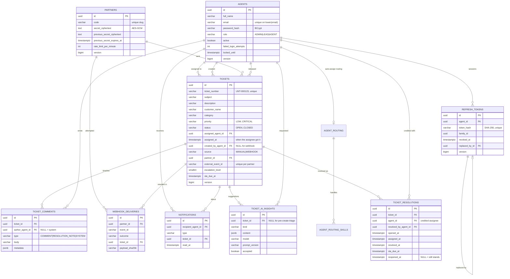

# Database design

## Simple explanation

Untangle stores everything in one PostgreSQL 18 database. There are three core tables, as the brief
asks:

- **agents**: the support staff (who are also the people who log in)
- **tickets**: one row per complaint
- **ticket_comments**: everything that happens on a ticket: comments, resolution notes and
  automatic events like "status changed" or "SLA breached"

Six supporting tables make the rest of the features work:

- **partners**: companies that send tickets through the webhook
- **webhook_deliveries**: a log of every webhook attempt
- **refresh_tokens**: login sessions
- **notifications**: the in-app bell
- **ticket_ai_insights**: AI suggestions and whether agents found them useful
- **shedlock**: makes sure only one server runs the SLA checker

Important rules are enforced **inside the database**, not only in Java code. A ticket can't have
priority `"high"` (lowercase), a partner can't create two tickets with the same event id, and
nobody can edit a comment after it's written. So even a bug in the application can't corrupt the
data.

## Technical details

Schema source of truth: [`V1__init.sql`](../backend/src/main/resources/db/migration/V1__init.sql)
(Flyway, [ADR-003](decisions/ADR-003-flyway-migrations.md)). Hibernate runs with
`ddl-auto=validate` and refuses to start if an entity and the schema disagree.

### Conventions

| Convention | Why | ADR |
|---|---|---|
| **UUIDv7** primary keys (`uuidv7()` in PG 18; Hibernate `@UuidGenerator(VERSION_7)`) | Generated before insert, unguessable in URLs, and time-ordered, so B-tree inserts stay at the right edge of the index (random v4 ids scatter writes) | [008](decisions/ADR-008-uuidv7-primary-keys.md) |
| `timestamptz`, always UTC (`hibernate.jdbc.time_zone=UTC`) | No ambiguity across servers and DST | — |
| Enums as `varchar` + `CHECK` | Adding a value is a plain migration; no `ALTER TYPE` lock or transaction limitations | [009](decisions/ADR-009-varchar-check-for-enums.md) |
| `version bigint` on mutable rows | Optimistic locking: a stale update fails instead of overwriting | [011](decisions/ADR-011-optimistic-locking.md) |
| Constraints mirror business rules | Defence in depth: the database rejects invalid states even if Java has a bug | this doc |
| Named constraints (`ck_`, `uq_`, `ux_`, `ix_`) | Error messages and tests can say exactly which rule fired | — |

### Entity–relationship diagram



### Tables

#### `agents`: support staff and system users
Who uses it: everyone logs in as an agent; admins manage the rows.

| Column | Type | Notes |
|---|---|---|
| `id` | uuid PK | v7 |
| `full_name` | varchar(120) | ≥ 2 non-blank chars |
| `email` | varchar(254) | format check; **unique on `lower(email)`** |
| `password_hash` | varchar(100) | BCrypt cost 12 (Phase 2) |
| `role` | varchar(10) | `ADMIN`, `LEAD`, `AGENT` |
| `active` | boolean | never hard-deleted (A13) |
| `failed_login_attempts`, `locked_until` | int, timestamptz | lockout after 5 failures (Phase 2) |
| `last_login_at`, `created_at`, `updated_at`, `version` | | |

#### `tickets`: one row per complaint
Who uses it: everyone; it's the product.

| Column | Type | Notes |
|---|---|---|
| `ticket_number` | varchar(20) | `DEFAULT next_ticket_number()`, read back by Hibernate (`@Generated`) |
| `subject` / `description` | varchar(150) / varchar(5000) | description ≥ 10 chars |
| `customer_name` / `customer_email` | varchar(120) / varchar(254) | email optional |
| `category`, `priority`, `status`, `source` | varchar + CHECK | case-sensitive enum values |
| `assigned_agent_id` | FK agents, `ON DELETE RESTRICT` | NULL = unassigned queue |
| `assigned_at` | timestamptz | when the current assignee got it; NULL while unassigned (V7, ADR-030) |
| `created_by_agent_id` | FK agents | **NULL iff webhook** (`ck_tickets_creator`) |
| `partner_id`, `external_event_id` | FK partners, varchar(128) | **set iff webhook** (`ck_tickets_source_consistency`) |
| `escalation_level`, `reopened_count` | smallint, int | ≥ 0 |
| `sla_due_at` | timestamptz | set at creation, recalculated on priority change (Phase 3/5) |
| `first_response_at`, `resolved_at`, `closed_at` | timestamptz | lifecycle timestamps |

Lifecycle invariants enforced by the database (mirroring `TicketStateMachine`):

| Constraint | Rule |
|---|---|
| `ck_tickets_closed_has_timestamp` | `CLOSED` ⇒ `closed_at` set |
| `ck_tickets_resolved_has_timestamp` | `RESOLVED` ⇒ `resolved_at` set |
| `ck_tickets_in_progress_assigned` | `IN_PROGRESS` ⇒ has an assignee |

**Ticket numbers.** `next_ticket_number()` calls `nextval('ticket_number_seq')` once and formats it
as `UNT-` plus at least 6 digits. A sequence is concurrency-safe without locks (unlike
`SELECT max()+1`). Gaps are possible after rolled-back inserts; that's acceptable for display ids.
Past 999 999 the width grows to `UNT-1000000` instead of truncating (tested).

#### `ticket_comments`: append-only timeline
Who uses it: agents and leads read and write it; it doubles as the audit trail.

- `author_agent_id` NULL = written by the system. `ck_comments_author`: only `SYSTEM` entries may be
  authorless.
- `metadata jsonb`: structured facts for system events, e.g. `{"event":"STATUS_CHANGED","from":"OPEN","to":"IN_PROGRESS"}`.
  The UI renders rich timeline items from it without parsing text.
- **Append-only:** the trigger `trg_ticket_comments_append_only` rejects every `UPDATE`, and the
  entity is `@Immutable` ([ADR-010](decisions/ADR-010-append-only-comments.md)).
- `ON DELETE CASCADE` from tickets: comments can't outlive their ticket (tickets are never deleted
  in practice).

#### `partners`
Who uses it: the webhook filter looks partners up by `code`; admins manage them.
`code` is a lowercase slug (`ck_partners_code_format`) because it travels in the `X-Partner-Id`
header. The HMAC secret is **encrypted** (AES-256-GCM), because it must be recoverable to verify
signatures. During rotation, `previous_secret_ciphertext` and `previous_secret_expires_at` are set
together or not at all (`ck_partners_previous_secret`).

#### `webhook_deliveries`
Who uses it: admins debugging partner integrations. One row per attempt, accepted or rejected.
Stores `payload_sha256`, **never the body** (PII minimisation). A `CREATED`/`DUPLICATE` outcome must
link its ticket (`ck_deliveries_ticket`). 30-day retention job (Phase 4) via
`WebhookDeliveryRepository.deleteReceivedBefore`.

#### `refresh_tokens`
Who uses it: the auth flow (Phase 2). Only the SHA-256 `token_hash` is stored. `family_id` groups
one login's rotated tokens; reuse of a rotated token revokes the family in one `UPDATE`.
`version` makes two concurrent refreshes of the same token race safely (one wins).

#### `notifications`
Who uses it: agents and leads (bell and drawer). Marking read is idempotent, so there's no version.

#### `ticket_ai_insights`
Who uses it: agents and leads (AI panel); we use it to measure AI usefulness. `ticket_id` may be
NULL only for `TRIAGE` (run on the create form before the ticket exists).

#### `shedlock`
ShedLock's lock table (Phase 5), so only one backend instance runs the SLA scheduler (and the
auto-assign sweep) at a time.

#### `auto_assign_settings`, `agent_routing`, `agent_routing_skills` (V6, ADR-029)
Who uses them: leads and admins on the Auto-assign screen; the auto-assign planner.
- `auto_assign_settings`: one row (unique index on `(true)`) with the switch and the per-agent cap
  (`ck_auto_assign_settings_cap`, 1–100). No row = off.
- `agent_routing`: whether an agent takes automatic work, and when they last got a ticket that
  way (round-robin tie-break). No row = defaults.
- `agent_routing_skills`: the categories an agent handles; none = all.
- `tickets.released_by_agent_id`: who last gave the ticket back, so they aren't handed it again.
- `ix_tickets_unassigned_queue (sla_due_at, id) WHERE status = 'OPEN' AND assigned_agent_id IS
  NULL`: the queue the planner walks with keyset paging and `FOR UPDATE SKIP LOCKED`.

#### `ticket_resolutions` (V7, ADR-030)
Who uses it: leads and admins on the Performance screen. One row per RESOLVE, credited to the
assignee at that moment (`resolved_by_agent_id` = who pressed the button). Written once; only
`reopened_at` is set later, when the ticket is reopened or sent back to work.
- `ck_resolutions_order`: `opened_at ≤ assigned_at ≤ resolved_at`.
- `ux_ticket_resolutions_standing (ticket_id) WHERE reopened_at IS NULL`: one standing resolution
  per ticket.
- `ix_ticket_resolutions_resolved_agent (resolved_at, agent_id)`: the period filter.

### Index rationale

| Index | Serves | Why this shape |
|---|---|---|
| `ux_agents_email_lower` (unique, expression) | login lookup, uniqueness | Spring Data `findByEmailIgnoreCase` generates `lower(email) = lower(?)`, which matches this expression index exactly |
| `uq_tickets_number` | open ticket by `UNT-…`, command palette | unique lookup |
| `ux_tickets_partner_event` (unique, **partial** `WHERE external_event_id IS NOT NULL`) | webhook idempotency | the **source of truth** for "no duplicate tickets"; partial so manual tickets don't bloat it |
| `ix_tickets_status_priority` | dashboard breakdowns, default list filters | status is the most selective first filter in nearly every list query |
| `ix_tickets_assignee_status` | "My open tickets", workload, "agent has open tickets?" | equality on assignee, then status |
| `ix_tickets_created_at` (DESC) | default sort, 14-day trends | newest-first scans without a sort step |
| `ix_tickets_sla_due_unresolved` (**partial**) | SLA scheduler every minute | only `OPEN`/`IN_PROGRESS` rows can breach, so the index stays tiny as closed tickets pile up |
| `ix_tickets_subject_trgm`, `ix_tickets_description_trgm` (V1), `ix_tickets_number_trgm`, `ix_tickets_customer_trgm` (V3) (GIN, `pg_trgm`) | `q` search | lets `ILIKE '%term%'` use an index. Search ORs **all four** columns, so all four must be indexed: with only two, the OR fell back to a full scan (found by the stress test, fixed in V3) |
| `ix_comments_ticket_created` | timeline | equality on ticket, ordered by time |
| `ix_deliveries_received_at`, `ix_deliveries_partner` | webhook logs, retention | newest first, optionally per partner |
| `ix_refresh_tokens_family`, `ix_refresh_tokens_agent_live` (partial) | reuse detection, logout/deactivation | revoke-by-family and revoke-live-by-agent |
| `ix_notifications_recipient`, `ix_notifications_unread` (partial) | drawer, unread badge | the badge count touches only unread rows |
| `ix_ai_insights_ticket` | latest summary/draft for a ticket | |

**Deliberately not indexed:** `tickets.created_by_agent_id` (never filtered on; agents are never
deleted, so FK checks don't need it); `agents.role` (a few dozen rows; a sequential scan is faster).

#### V2 additions (Phase 3)

| Column / index | Why |
|---|---|
| `sla_started_at` | when the SLA clock (re)started: creation or latest reopen. A priority change recomputes `sla_due_at` from the same start; a reopen restarts it (R4) |
| `priority_rank`, `status_rank` (generated `STORED` columns) | sorting by *severity* (CRITICAL > HIGH > MEDIUM > LOW) and lifecycle order; the enum names sort alphabetically, which would be wrong |
| `ix_tickets_queue (status_rank, priority_rank DESC, created_at)` | "work queue" ordering for an unresolved-first view |

### Query plans (Section 15: verified with `EXPLAIN ANALYZE`)

Measured on PostgreSQL 18.7 with **200,000 synthetic tickets** (10% OPEN, 10% IN_PROGRESS, 20%
RESOLVED, 60% CLOSED; 50 agents), warm cache, `ANALYZE` run first. With the 60-row demo data the
planner rightly prefers sequential scans, so the numbers only mean something at volume.

| Query (as issued by the app) | Plan | Execution |
|---|---|---|
| Default list: unresolved, newest first, `LIMIT 20` | Index Scan `ix_tickets_created_at` + incremental sort; stops after 21 rows | **0.10 ms** |
| "My open tickets" (assignee + status, newest first) | Index Scan `ix_tickets_created_at`, filter on assignee/status | **0.59 ms** |
| SLA breached / scheduler (`status IN unresolved AND sla_due_at < now()`) | Index Scan on **partial** `ix_tickets_sla_due_unresolved`, with no filter step at all | **0.08 ms** |
| Search `q=…` (`ILIKE` on number OR subject OR customer OR description) | BitmapOr of the four **pg_trgm GIN** indexes (V3) | **8 ms** for a selective term; a term matching ~12 % of all rows still scans, which is correct |
| Severity queue (`status_rank, priority_rank DESC, created_at`) | Index Scan `ix_tickets_queue`, index order = result order | **0.05 ms** |

How to reproduce: the SQL used is in `docs/how-it-works/phase-3.md` §6.

**Observation, not yet acted on:** "My open tickets" walks `ix_tickets_created_at` and filters about
3,000 rows to find 20, because the planner prefers the sort order over `ix_tickets_assignee_status`.
Fine at this scale (0.6 ms). At 10× volume, add `(assigned_agent_id, status, created_at DESC)`
(recorded in scalability.md).

### Demo data (`demo` profile)

`db/seed-demo/R__demo_data.sql` is a Flyway *repeatable* migration that lives outside the main
migration folder, so it only runs when the `demo` profile adds its location. The `dev` profile
includes `demo`.

- 1 admin, 2 leads, 6 agents. Password for all: `Untangle@2026` (BCrypt cost 12).
- 1 partner (`acme-bank`). Its secret is a placeholder until Phase 4 adds encryption.
- 60 tickets over about 10 days: OPEN 15, IN_PROGRESS 10, RESOLVED 13, CLOSED 22. They cover every
  priority and category; 15 came via the webhook, some are unassigned, and 12 are breached and
  escalated.
- About 200 timeline entries (comments, resolution notes, status changes, SLA breaches) and unread
  SLA notifications for the leads.
- 37 resolution facts (ADR-030): one per RESOLVED/CLOSED ticket plus two that were reopened. The
  agents work at three different speeds, so the Performance screen shows real differences.

It's idempotent: ids are `md5(stable key)::uuid` and every insert is `ON CONFLICT DO NOTHING`.
`DemoSeedIntegrationTest` proves it loads and covers every state.

### How to look at the data

```bash
make db-shell                   # psql inside the container
# or pgAdmin: host localhost, port 5433, db/user untangle, password from .env
```
