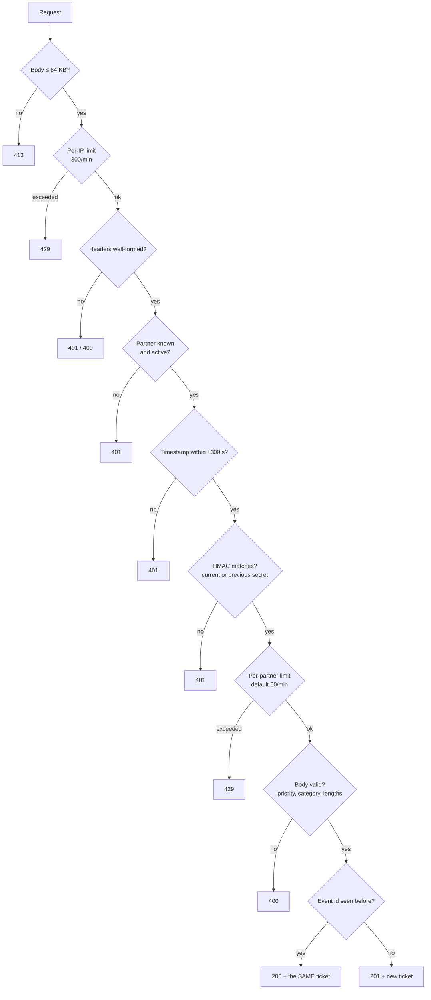

# Engineering decisions, trade-offs and how the key parts work

## Simple explanation

This is the one page to read before explaining Untangle to someone. It lists every important
choice we made, **why** we made it and **what it costs**. It explains in detail the three parts
people ask about most:

- **the escalation system:** when and why a ticket gets escalated;
- **the partner webhook and its HMAC check:** how an outside company creates tickets safely;
- **scalability:** what is already built so the app can grow, what we measured, and what comes next.

Each decision links to its full ADR (Architecture Decision Record) in [decisions/](decisions/).

## Technical details

### 1. Architecture

| Decision | Why | Trade-off (what it costs) |
|---|---|---|
| **Modular monolith, package-by-feature** ([ADR-001](decisions/ADR-001-modular-monolith-package-by-feature.md)): `auth agent ticket comment webhook escalation notification dashboard ai`, each with `api → application → domain / infrastructure` | one team, one database, one deploy; transactions across features stay simple | module boundaries depend on discipline, so **ArchUnit tests** (`ArchitectureTest`) fail the build if a feature reaches into another's repositories |
| **Two entry doors, one brain**: the JWT REST API and the HMAC webhook both call `TicketService` | priority checks, the closed-ticket rule and duplicate handling cannot differ between channels | the service has to handle two kinds of actor (a person, a partner) |
| **Java 21 + Spring Boot 4.1** ([ADR-002](decisions/ADR-002-java-21-spring-boot-4.md)) | LTS Java; current Spring with modular starters | Boot 4 is new, so APIs were checked against the actual jars and sources |
| **Plain DTOs on success, RFC 9457 Problem Details on error** ([ADR-007](decisions/ADR-007-response-and-error-format.md)) | standard error shape with `code` + `traceId`; the frontend maps `code` to a message | no "envelope", so clients read the HTTP status |
| **Business rules on the server; UI shows `allowedActions`** ([ADR-015](decisions/ADR-015-allowed-actions-from-server.md)) | the same `TicketAccessPolicy` decides both "may I?" and "which buttons to show", so they can't drift | a slightly bigger ticket payload |
| **Synchronous webhook processing** | the partner gets a definite answer (201/200) at once; no broker to run | a burst is rate-limited (429) rather than queued; outbox + queue is the documented next step |
| **Redis optional** ([ADR-005](decisions/ADR-005-redis-optional.md)) | `make up` needs nothing extra; correctness never depends on a cache | without the `redis` profile, caches and rate limits are per instance |

### 2. Database (PostgreSQL 18)

| Decision | Why | Trade-off |
|---|---|---|
| **PostgreSQL** | strong constraints, partial indexes, `SELECT … FOR UPDATE`, JSONB for timeline metadata | none significant at this size |
| **Flyway SQL migrations, Hibernate `validate`** ([ADR-003](decisions/ADR-003-flyway-migrations.md)) | schema changes are reviewed, repeatable SQL; Hibernate never changes the schema | migrations are written by hand; an applied file is never edited |
| **UUIDv7 primary keys** ([ADR-008](decisions/ADR-008-uuidv7-primary-keys.md)) | not guessable, time-ordered (good index locality), can be made anywhere | 16 bytes per key; readable `UNT-000123` numbers are a separate unique column |
| **Enums as `varchar` + `CHECK`** ([ADR-009](decisions/ADR-009-varchar-check-for-enums.md)) | adding a value is a simple migration | slightly more storage than PG enums |
| **Rules mirrored as named DB constraints** (defence in depth) | even a bug or a manual SQL edit can't break the rules: valid priority (`ck_tickets_priority`), `IN_PROGRESS` needs an assignee, `CLOSED` needs `closed_at`, webhook tickets always have partner + event id | rules exist twice (Java + SQL) and must be kept in step |
| **Idempotency by a unique index** ([ADR-012](decisions/ADR-012-db-unique-constraint-for-idempotency.md)): `ux_tickets_partner_event (partner_id, external_event_id)` | correct under concurrency, restarts and many instances | a duplicate costs one failed insert and a lookup |
| **Optimistic locking** (`@Version`, [ADR-011](decisions/ADR-011-optimistic-locking.md)) | no waiting; two people editing the same ticket can't silently overwrite each other | the second person sees "this ticket changed" and reloads |
| **Append-only comments** ([ADR-010](decisions/ADR-010-append-only-comments.md)) | a trustworthy audit trail | typos stay; a correction is a new comment |
| **Tickets are closed, never deleted** | history and metrics stay complete | the table only grows (partitioning is the plan) |
| **Soft delete for agents and partners** (deactivate) | foreign keys and history stay intact | inactive rows remain in the tables |
| **Indexes match the filters** (composite and partial, e.g. `ix_tickets_sla_due_unresolved`) | list, filter and SLA queries use indexes; verified with `EXPLAIN ANALYZE` at 200k tickets ([database.md](database.md)) | a little extra write cost per index |

Tables: `agents`, `tickets`, `ticket_comments` (the three required), plus `partners`,
`webhook_deliveries`, `notifications`, `refresh_tokens`, `ai_insights`, `shedlock`.

### 3. Ticket rules

| Decision | Why | Trade-off |
|---|---|---|
| **Explicit state machine**: OPEN → IN_PROGRESS → RESOLVED → CLOSED, plus reopen ([state-machine.md](state-machine.md)) | every move is a named action with its own checks, so there are no "jumps" | adding a status means updating the machine and its tests |
| **A closed ticket is immutable until reopened** | required rule; every mutation runs `ensureNotClosed` first and returns 409 `TICKET_CLOSED` | none |
| **Resolving needs a resolution note** | the note is the record of what was done | one more field for the agent |
| **Only leads and admins close and reopen** (configurable: `agent-can-close-own-resolved`) | a second pair of eyes before a ticket is final | more work for leads |
| **Every mutation in a fixed order**: load → `ensureNotClosed` → `checkVersion` → `TicketAccessPolicy.require` → entity method → timeline entry → event | the same guarantees on every path | more code per action, but simpler reviews |
| **Entities have no setters** (factories and behaviour methods only) | invalid states can't be created by accident | more methods to write |

### 4. The escalation system (on what basis?)

**The basis is the SLA (Service Level Agreement): how long a ticket may wait, decided by its
priority.**

| Priority | SLA target (`app.tickets.sla.*`) |
|---|---|
| CRITICAL | 1 hour |
| HIGH | 4 hours |
| MEDIUM | 24 hours |
| LOW | 72 hours |

How it works:

1. **On create:** `sla_started_at = now`, `sla_due_at = now + target(priority)`.
2. **On priority edit:** the deadline is recalculated from the **same** start time, so changing the
   priority doesn't reset the clock.
3. **Every minute**, one server runs the SLA scan. For each OPEN or IN_PROGRESS ticket past its
   deadline:
   `level = min(3, floor((now − sla_started_at) / target))`.
   - Level 1 = late by 1× the target (for example, a HIGH ticket after 4 h);
   - Level 2 = 2× the target (8 h); Level 3 = 3× the target (12 h), which is the cap (`max-level`).
4. **What escalation does:** raises `escalation_level`, writes a system timeline entry
   (`SLA_BREACH`, level), and notifies **all active leads + the assignee**.
5. **Manual escalation:** anyone can escalate with a **reason**; it adds 1 level and notifies the
   leads + assignee.
6. **Resolved/closed tickets** stop the SLA clock ("SLA stopped"). **Reopen** restarts the clock
   and resets the level to 0.

Why this design ([ADR-020](decisions/ADR-020-sla-scheduler-with-shedlock.md)):

| Option | Verdict |
|---|---|
| Plain `@Scheduled` | rejected: with 3 servers every ticket would be escalated 3 times |
| A delayed message per ticket on a queue | rejected: new infrastructure, and every priority change or reopen would need to reschedule |
| **One scan per minute + ShedLock + idempotent levels + row locks** | **chosen** |

- **ShedLock** (`shedlock` table, database time) lets only one instance run the scan each minute.
- **Idempotent:** the level is calculated from time and only ever goes **up**
  (`escalateToAtLeast`), so running the scan twice changes nothing.
- **Row locks** (`SELECT … FOR UPDATE`) mean two overlapping runs can't both escalate one ticket.
- A manual level higher than the calculated one is kept.

Trade-offs: up to about 1 minute between the deadline and the escalation; one indexed query every
minute (0.08 ms for 100 breached rows at 200k tickets). Tested in `SlaEscalationIntegrationTest`,
including "two concurrent runs → each ticket escalated once".

### 5. Partner webhook and HMAC verification

**What it is:** partner companies (for example a bank) send complaints to Untangle by HTTP. Each
request is **signed** with a secret only that partner and Untangle know, so we can prove who sent
it and that nobody changed it on the way.

**Endpoint:** `POST /api/v1/webhooks/partners/tickets`. Full partner guide:
[webhook-integration-guide.md](webhook-integration-guide.md).

**Headers the partner sends:**

| Header | Meaning |
|---|---|
| `X-Partner-Id` | partner code, e.g. `acme-bank` |
| `X-Event-Id` | the partner's unique id for this complaint; **the same id on every retry** |
| `X-Timestamp` | Unix seconds when signed |
| `X-Signature` | `sha256=` + hex of `HMAC-SHA256(secret, timestamp + "." + rawBody)` |

**Why sign `timestamp.rawBody`** ([ADR-017](decisions/ADR-017-hmac-over-timestamp-and-raw-body.md)):

- The **raw bytes** are signed, not re-formatted JSON, so there's no ambiguity about spaces or
  field order.
- The **timestamp is inside** the signature, so an attacker can't take an old request and resend it
  with a new time.

**The pipeline, in order** (`WebhookBodyLimitFilter` → `WebhookService.process`):

| Step | What happens | Why in this position |
|---|---|---|
| 1. Body limit | `WebhookBodyLimitFilter` rejects > 64 KB and keeps the exact raw bytes | the signature needs the untouched bytes; huge bodies are refused before any work |
| 2. Per-IP rate limit | 300 requests/min per IP (Bucket4j) | stops floods **before** spending CPU on crypto |
| 3. Header checks | formats of partner id, event id, timestamp, signature | cheap checks first |
| 4. Partner lookup | must exist and be active | — |
| 5. Freshness | timestamp within **±300 s** (both past and future) | replay protection |
| 6. **HMAC check** | recompute HMAC-SHA256 with the partner's secret over `timestamp.rawBody`; compare in **constant time** (`MessageDigest.isEqual`); during a rotation the **previous** secret also works for 24 h | constant time so response timing leaks nothing; the grace period means partners can switch without downtime |
| 7. Per-partner rate limit | default 60/min, set per partner | only now is the partner proven, so it's safe to key on it |
| 8. Validate the body | a valid signature proves **who** sent it, not that the data is right; bad priority → 400 | — |
| 9. Idempotent create | look up `(partner, eventId)`; if absent, insert. If 20 retries race, the **unique index** lets exactly one insert win; the others get the existing ticket | correctness comes from the database, not from timing |

Every outcome (created, duplicate, rejected and why, rate-limited) is stored in
`webhook_deliveries` in its **own transaction** (`DeliveryRecorder`, `REQUIRES_NEW`), so even
failures are logged. Admins see this as **Webhook logs**. Rows are kept 30 days (daily purge).

Security decisions around it:

| Decision | Why | Trade-off |
|---|---|---|
| **Generic 401 for every auth failure** ([ADR-018](decisions/ADR-018-generic-webhook-errors-and-delivery-log.md)) | an attacker can't tell "unknown partner" from "wrong signature" | partners debug through the admin's delivery log |
| **200 (not 409) for a duplicate, with the original ticket** | retries are normal; the partner gets the ticket it created | a duplicate with a **different** body is flagged in the log ("payload differs") |
| **Secrets encrypted with AES-256-GCM, not hashed** ([ADR-016](decisions/ADR-016-aes-gcm-partner-secrets.md)) | HMAC needs the real secret to recompute; encryption at rest, with the partner code as AAD, so a secret can't be copied to another partner's row | losing `APP_SECRET_ENCRYPTION_KEY` means rotating all secrets |
| **Secret shown once** at creation/rotation | it is never readable again from the UI or API | the partner must store it |

Proof: `make simulate` runs 13 scenarios. They cover: valid → 201; same event → 200 with the same
ticket; 20 parallel retries → 1 ticket; wrong secret, tampered body, old timestamp, unknown
partner → 401; bad priority → 400; > 64 KB → 413; burst → 429; old secret during rotation → accepted.

### 6. Security and access

| Decision | Why | Trade-off |
|---|---|---|
| **JWT (HS256) + rotating refresh token in an HttpOnly cookie** ([ADR-013](decisions/ADR-013-jwt-and-refresh-rotation.md)) | stateless API that scales horizontally; a reused refresh token revokes the family | revocation needs the `refresh_tokens` table |
| **Access token kept in memory only** | XSS can't read a stored token | a silent refresh on each page load |
| **Permissions, not role names** ([ADR-014](decisions/ADR-014-rbac-via-permissions.md)): AGENT ⊂ LEAD ⊂ ADMIN | roles can change without touching endpoints | one mapping (`RolePermissions`) to maintain |
| **Principal reloaded from the DB per request (30 s cache)** | deactivation and role changes apply almost at once, not when the token expires | one cached lookup per request |
| **Login rate limits and account lockout** (20/min per IP, 10/min per email; 5 wrong passwords lock the account for 15 min) | stops password guessing | a real user can be locked out briefly |
| **Never echo rejected values; mask emails in logs** | no data leaks via errors or logs | harder debugging, so `traceId` links logs to errors |

### 7. Notifications and live updates

| Decision | Why | Trade-off |
|---|---|---|
| **Notifications written after commit** (`@TransactionalEventListener` + `REQUIRES_NEW`) | no notification for a change that was rolled back; a notification failure can't undo the ticket change | a notification can in rare cases be missing, but never wrong |
| **Who gets what**: assigned → assignee; escalated/SLA breach → active leads + assignee; reopened → assignee; never the actor | the people who must act are told; no noise | comments don't notify (the open ticket refreshes itself) |
| **Polling, not WebSockets/SSE** ([ADR-021](decisions/ADR-021-notifications-polling-over-sse.md)): bell 15 s, open ticket 10 s, lists 20 s, dashboard 60 s; paused in hidden tabs | works through any proxy and load balancer, no sticky connections | updates arrive within seconds, not instantly |

### 8. AI (optional)

| Decision | Why | Trade-off |
|---|---|---|
| **Suggestion-only** ([ADR-022](decisions/ADR-022-ai-suggestion-only.md)): triage, summary, resolution-note draft | a wrong or manipulated answer can't change data | one extra click to accept |
| **Redact PII, wrap ticket text in `<ticket_data>`, validate every field** | privacy and prompt-injection defence | some context is lost to redaction |
| **Timeout (8 s) + circuit breaker; app works fully without AI** | the provider being down never breaks support work | — |

### 9. Frontend

| Decision | Why | Trade-off |
|---|---|---|
| **React 19 + Vite + TypeScript, server state in TanStack Query** | caching, retries and polling come for free | — |
| **Types generated from OpenAPI** ([ADR-023](decisions/ADR-023-exact-api-contract-and-vendored-react-bits.md)) | frontend types can't drift from the backend | `@Nullable` must be remembered on new optional fields |
| **Filters in the URL** | shareable links, Back button works | URL values must be validated |
| **Nebula glass, sixteen colour themes; 3D only in contained stages (login story, dashboard orbit); heavy libraries lazy-loaded** ([ADR-024](decisions/ADR-024-motion-and-3d-budget.md), [ADR-025](decisions/ADR-025-frosted-glass-colour-themes-and-ambient-3d.md), [ADR-026](decisions/ADR-026-nebula-glass-and-contained-3d-stages.md)) | premium, personal look; 3D tells the product story without ever covering content; work screens carry no WebGL; reduced motion respected, 3D switchable off | two scenes to maintain, each with a static fallback; backdrop blur still costs GPU on large screens |

### 10. Scalability

**Built now:**

| Feature | What it gives |
|---|---|
| **Stateless API** (JWT, no server session) | run any number of backend copies behind a load balancer |
| **ShedLock** | the SLA scan runs once per minute in total, however many copies run |
| **DB-enforced idempotency** | duplicate protection works across copies and restarts |
| **Pagination everywhere** (max 100 per page) | no unbounded responses |
| **Indexes per filter**, checked with `EXPLAIN ANALYZE` at 200k tickets | fast lists and counts as data grows |
| **No N+1 queries** (fetch joins; `QueryCountIntegrationTest`) | list, timeline and workload take 1–3 SQL statements regardless of size |
| **HikariCP pool** (`DB_POOL_MAX_SIZE`) | controlled DB connections |
| **Dashboard cache** (30 s, evicted on every ticket change); Caffeine or **Redis** (`redis` profile) | fast dashboard; shared across copies with Redis |
| **Rate limiting** (Bucket4j) in memory or **in Redis** | limits hold across all copies |
| **Metrics** (Micrometer → Prometheus → Grafana), `/livez` and `/readyz` | see load and health; orchestrators know when a copy is ready |
| **Static frontend from nginx**, immutable caching, code splitting | cheap to serve, CDN-ready |

**Stress-tested** (`make stress`, 200k tickets, realistic mix): one backend sustains about **375 req/s with 0 % errors** (about 1,800 people online); the database CPU is the limit. The test found and fixed a search full-scan, a dashboard cache stampede and a virtual-thread pinning freeze ([scalability.md](scalability.md#stress-test-where-does-one-server-break-make-stress)).

**Measured** (k6 on a laptop, through nginx): ticket list at 50 req/s → p95 **5.3 ms**, 0 % errors;
webhook at 4 req/s → p95 21 ms; a burst of 50 req/s from one IP → limiter returns 429 cleanly.

**Next steps (documented, not built)** in [scalability.md](scalability.md):

- read replicas for the dashboard;
- an outbox + queue (Kafka/RabbitMQ) for webhook bursts;
- monthly partitioning of `tickets` and `webhook_deliveries`;
- OpenSearch for free-text search;
- a CDN;
- SSE via Redis pub/sub to replace polling.

### 11. Where to read more

- [tradeoffs.md](tradeoffs.md): all 23 trade-offs in one table.
- [decisions/](decisions/): 24 ADRs, each with context, options, decision and consequences.
- [security.md](security.md): threat model.
- [architecture.md](architecture.md): diagrams and request flows.
- [database.md](database.md): tables, constraints, indexes and query plans.
