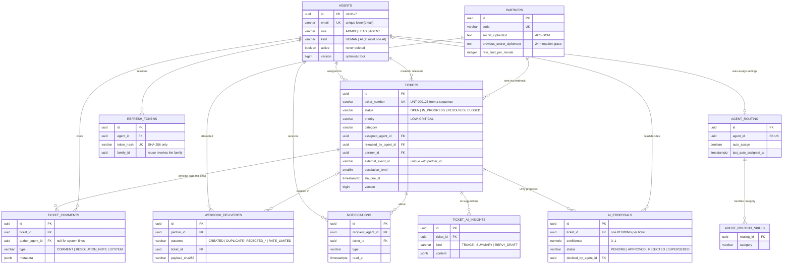
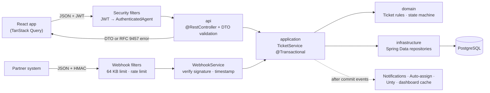
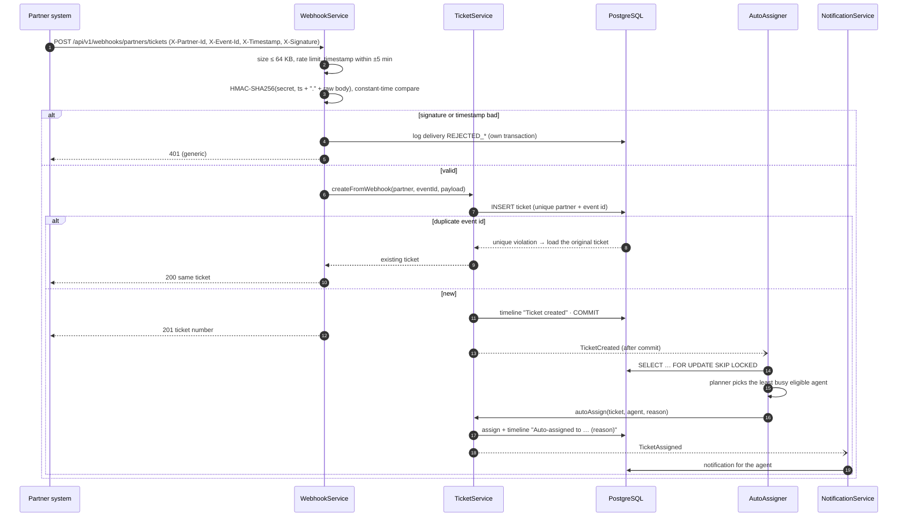
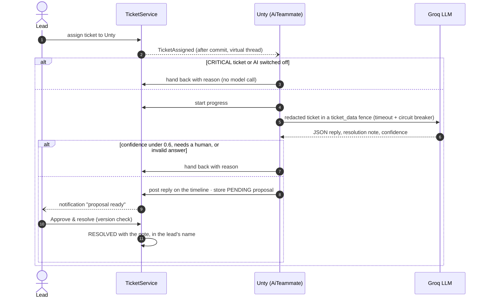

# Untangle: project overview

*"Every complaint, untangled."* One page covering what the project is, what it does, the decisions
that shaped it, the edge cases it guards, its data model and how a request flows.

## Simple explanation

Untangle is a **support ticket and escalation platform**. Complaints arrive in two ways:
- **The support team** types them into the web app.
- **Partner companies** send them automatically through a signed webhook.

Every complaint becomes a ticket (`UNT-000123`). Each ticket gets an owner, a deadline (SLA) and a
full history. If nobody acts in time, it escalates by itself, so nothing gets lost.

There are three kinds of people, plus an AI teammate:

| Who | What they do |
|---|---|
| **Agent** | works their own tickets |
| **Lead** | assigns work, approves, closes, sees team workload |
| **Admin** | everything a lead does, plus managing people and partner companies |
| **Unty (AI teammate)** | drafts replies and proposes resolutions; a lead approves them |

## Technical details

| | |
|---|---|
| Backend | Java 21, Spring Boot 4.1 (Web MVC REST), Spring Security (JWT + RBAC), JPA/Hibernate |
| Database | PostgreSQL 18, Flyway migrations V1–V6, Hibernate `validate` |
| Frontend | React 19 + TypeScript 6, Vite, TanStack Query, Tailwind v4 (neo-brutalist UI, toon 3D) |
| Architecture | Modular monolith, package-by-feature, layered `api → application → domain / infrastructure`, enforced by ArchUnit |
| Runs as | Docker Compose: frontend :3000, backend :8080, Postgres :5433 |

---

## 1. Features so far

| Area | What it does |
|---|---|
| **Tickets** | Create, edit, assign, comment. Lifecycle OPEN → IN_PROGRESS → RESOLVED → CLOSED, with reopen. A resolution note is required. Closed tickets are read-only. |
| **Timeline** | Append-only history of every comment and system event; it can never be edited (DB trigger). |
| **Search & filters** | Status, priority, category, assignee, SLA breached, full-text (trigram index), paging and sorting. Also a board view and a command palette. |
| **SLA & escalation** | Deadline by priority (CRITICAL 1 h, HIGH 4 h, MEDIUM 24 h, LOW 72 h). A scheduled job raises the level 1 → 2 → 3 at each multiple of the target and notifies leads. |
| **Auto-assign** | Waiting tickets go to the least busy agent who handles that category, most urgent first, with a per-agent cap (ADR-029). |
| **Partner webhook** | HMAC-SHA256 signed, ±5 min timestamp window, idempotent on the partner's event id, rate-limited, 64 KB limit, every attempt logged. |
| **Security** | JWT access token (15 min, in memory) plus a rotating refresh cookie with reuse detection, account lockout, permission-based RBAC, the server deciding `allowedActions`. |
| **Dashboard** | Totals, trends, team workload, interactive 3D ticket stacks. |
| **Notifications** | Assigned, escalated, SLA breach, reopened, AI proposal and AI hand-back. |
| **AI (optional, Groq)** | Triage suggestion, summary and reply draft. The AI teammate **Unty** proposes resolutions that a lead approves (ADR-028). |
| **Admin** | Agents (roles, deactivate), partners (secret rotation with a 24 h grace period), webhook delivery logs. |
| **Quality** | 443 backend tests (Testcontainers Postgres), 74 frontend tests, 14 Playwright E2E tests, 17 webhook simulator scenarios, a layout guard at 4 screen sizes. |

---

## 2. Key decisions

### 1. Modular monolith, not microservices (ADR-001)

- **What:** one Spring Boot app and one database, split into feature modules: `ticket`, `webhook`,
  `assignment`, `ai`, and so on.
- **Rules:** a module only talks to another through its service or events, never through its
  repository. ArchUnit tests enforce this.
- **Why:**
  - It allows real ACID transactions. For example, a ticket and its timeline row commit together.
  - There's one thing to deploy and debug.
  - Any module could still be extracted into its own service later.

### 2. Two entry points, one brain

- **What:** the web app (JWT) and the partner webhook (HMAC) both call `TicketService`.
- **Pipeline:** every change follows the same steps:
  `load → ensureNotClosed → checkVersion → access policy → entity rule → timeline → event`.
- **Why:** a business rule written once applies everywhere. The UI only renders the
  `allowedActions` the server returns.

### 3. Escalation by SLA multiples, run safely on one server (ADR-020)

- **The rule:** `level = min(3, floor(time since SLA start / target))`. Level 1 is at the deadline,
  level 2 at twice the target, and so on.
- **How it runs:**
  - A job runs every minute.
  - **ShedLock** makes sure only one instance runs it.
  - Candidate rows are locked with `SELECT … FOR UPDATE`.
  - `escalateToAtLeast(level)` only ever moves the level up.
- **Why:** running it twice, or on two servers, never escalates a ticket twice.

### 4. Safe concurrency: optimistic locks for people, row locks for jobs (ADR-011, ADR-029)

- **For people:** every entity has a `@Version`, and the client sends the version it loaded. If
  two people edit at once, the second gets **409 VERSION_CONFLICT** instead of silently
  overwriting the first.
- **For jobs:**
  - Auto-assign reads the queue with `FOR UPDATE SKIP LOCKED`, so parallel runs never assign the
    same ticket.
  - Webhook duplicates are stopped by a unique index (ADR-012), not by checking first and
    inserting second.

---

## 3. Key edge cases

| Edge case | What happens | Proof (test) |
|---|---|---|
| **The same webhook arrives twice, or 20 copies in parallel** | One ticket is created. The first call gets 201; every other call gets 200 with the same ticket (unique index on partner + event id). | `WebhookIntegrationTest`, simulator `concurrent-duplicate` |
| **Two people edit the same ticket at once** | The second save gets 409 `VERSION_CONFLICT`; the UI shows a "This ticket changed" dialog and reloads. | `ConcurrencyIntegrationTest`, `TicketLifecycleIntegrationTest`, `ticket-detail.test.tsx` |
| **No agent is free or able to take a ticket** (all at the cap, nobody handles the category, or only leads exist) | The ticket waits in the queue and SLA escalation still watches it. An agent who released a ticket is never handed it straight back. Deactivating an agent with open tickets is refused (409 `AGENT_HAS_OPEN_TICKETS`). | `AutoAssignIntegrationTest`, `AgentAdminIntegrationTest` |
| **Tampered, replayed or stale webhook** (wrong secret, edited body, timestamp swapped or older than 5 min) | Rejected with the same generic 401 every time, so attackers learn nothing. The real reason is stored in `webhook_deliveries`. | `WebhookIntegrationTest`, 17/17 simulator scenarios |
| **The AI is unsure, or the ticket is CRITICAL** | Unty hands it back to a human with the reason. It never resolves anything on its own. | `AiTeammateIntegrationTest` |

---

## 4. Entity–relationship diagram

Two tables sit outside the diagram:
- `auto_assign_settings`: one row holding the switch and the cap.
- `shedlock`: one lock row per scheduled job.

Every rule above is also a named database constraint, for example `ck_tickets_in_progress_assigned`
and `ux_tickets_partner_event`. Full table notes are in [database.md](database.md).

---

## 5. How data flows

### 5a. One request through the layers

### 5b. Sequence: a partner webhook becomes an assigned ticket

### 5c. Sequence: Unty works a ticket and a lead approves

---

Related documents:
- [architecture.md](architecture.md)
- [database.md](database.md)
- [edge-cases.md](edge-cases.md) (every edge case with its test)
- [api.md](api.md)
- [decisions/](decisions/) (ADRs 001–029)
