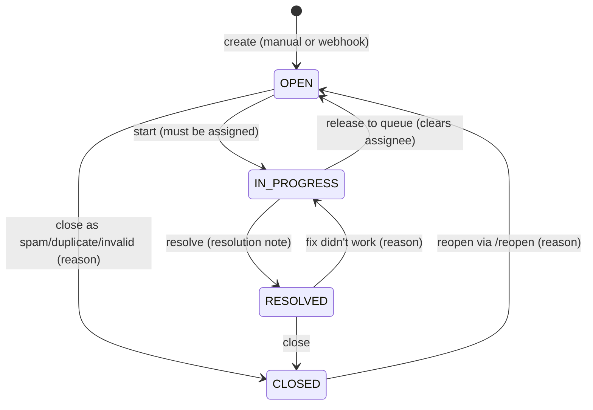

# Ticket state machine

## Simple explanation

A ticket moves through four states: **OPEN** (waiting), **IN_PROGRESS** (someone is on it),
**RESOLVED** (fixed, waiting for confirmation) and **CLOSED** (done and frozen). Only certain moves
are allowed, and some moves need extra information. For example, you can't mark a ticket resolved
without writing a resolution note. A closed ticket can't be changed at all until a lead reopens it.

The server decides which moves are allowed and tells the UI (`allowedActions`), so the screen never
offers a button the server would reject.

## Technical details

| From | To | Who | Conditions / side effects |
|---|---|---|---|
| OPEN | IN_PROGRESS | assignee, LEAD, ADMIN | must be assigned (`ASSIGNEE_REQUIRED`); sets `first_response_at` if null |
| OPEN | CLOSED | LEAD, ADMIN | `reason` required; sets `closed_at` |
| IN_PROGRESS | OPEN | assignee, LEAD, ADMIN | clears assignee |
| IN_PROGRESS | RESOLVED | assignee, LEAD, ADMIN | resolution note required (`RESOLUTION_NOTE_REQUIRED`); sets `resolved_at` |
| RESOLVED | IN_PROGRESS | assignee, LEAD, ADMIN | `reason` required |
| RESOLVED | CLOSED | LEAD, ADMIN (assignee if `app.tickets.agent-can-close-own=true`) | sets `closed_at` |
| CLOSED | OPEN | LEAD, ADMIN, only via `POST /tickets/{id}/reopen` | `reason` required; `reopened_count++`; keeps assignee unless inactive (R5); SLA recalculated (R4) |

**Rules**

- Any other move, including same-status → `409 INVALID_STATUS_TRANSITION`.
- Every successful move appends a `SYSTEM` timeline entry `{from, to, actor, reason}`.
- While `CLOSED`, every mutation except reopen → `409 TICKET_CLOSED` (one guard in the service layer).
- `GET /tickets/{id}` returns `allowedActions`, computed from this table **and** the caller's role.

Implementation (`TicketStateMachine`) and the exhaustive transition tests arrive in **Phase 3**.
